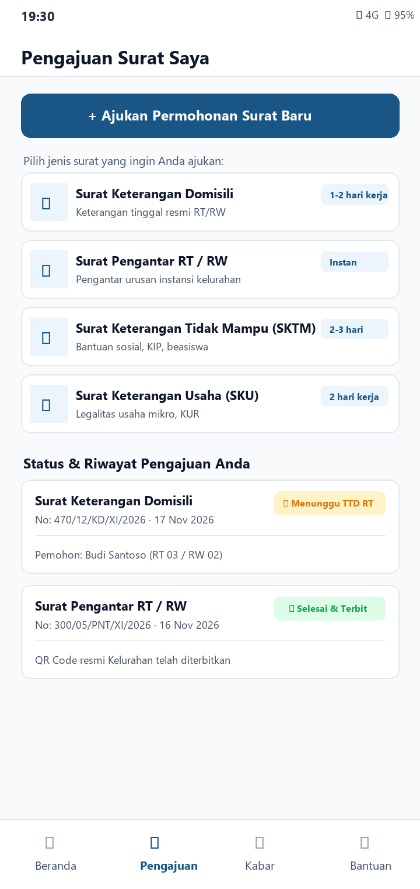
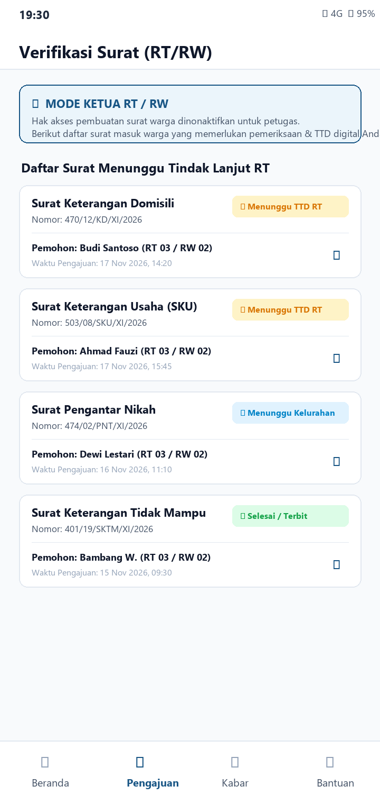
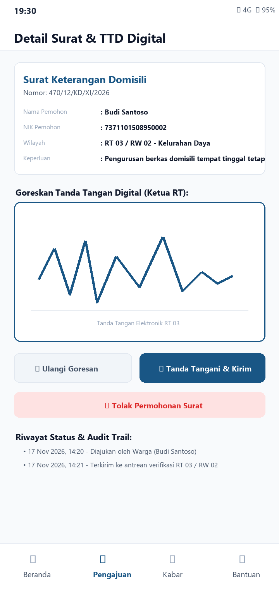
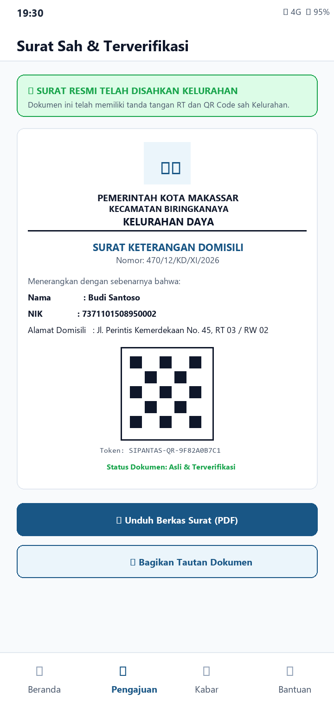
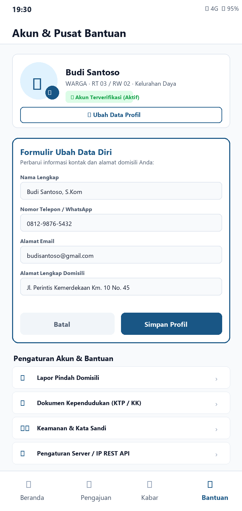
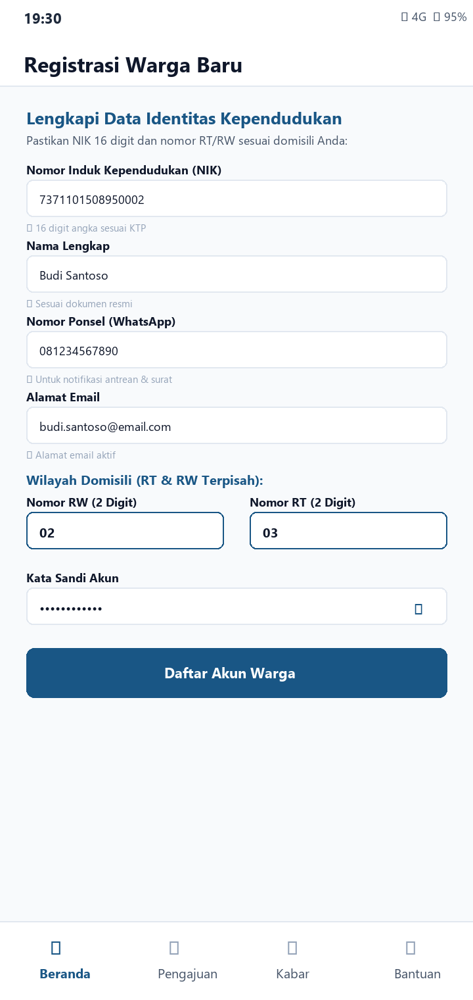
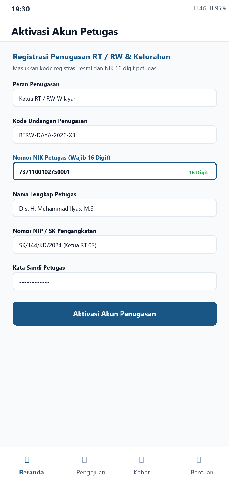
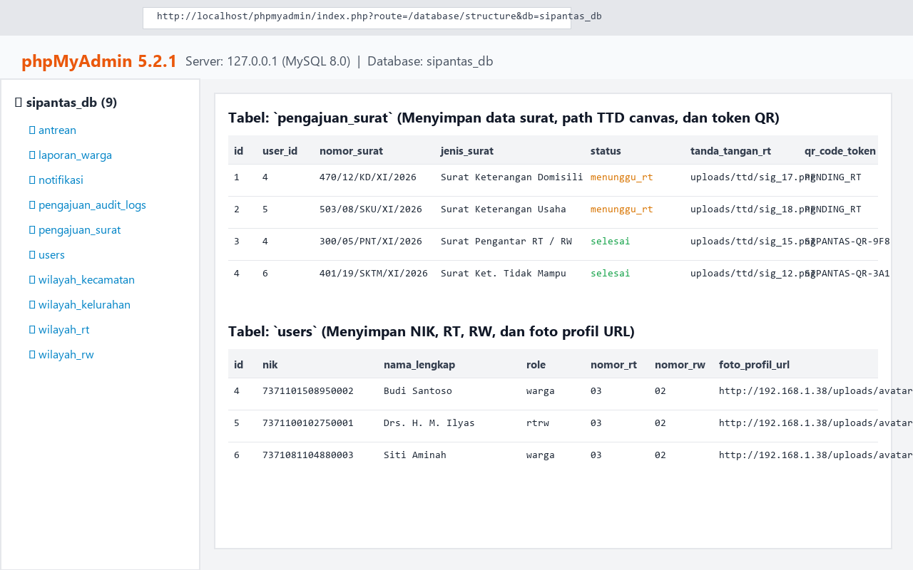

# DOKUMENTASI PROYEK SISTEM INFORMASI SIPANTAS
## (Sistem Pelayanan Administrasi Warga dan Rukun Tetangga)

* **Repositori GitHub:** [https://github.com/axelmlbb60-design/SIPANTAS](https://github.com/axelmlbb60-design/SIPANTAS)
* **Branch:** `main`
* **Status Kompilasi:** `BUILD SUCCESSFUL` (Android SDK 34 / Java 11 / Kotlin 1.9.0)
* **IP Server Backend Wi-Fi:** `http://192.168.1.38/api_sipantas/`

---

## 1. Pembuatan Fitur Utama

Sistem SIPANTAS mengintegrasikan alur birokrasi persuratan kependudukan secara berjenjang antara **Warga**, **Ketua RT/RW**, dan **Kelurahan/Kecamatan** secara paperless dan real-time.

### A. Pengajuan Surat Mandiri oleh Warga
Warga dapat memilih 4 kategori layanan surat:
1. *Surat Keterangan Domisili*
2. *Surat Pengantar RT / RW*
3. *Surat Keterangan Tidak Mampu (SKTM)*
4. *Surat Keterangan Usaha (SKU)*

Tab **Pengajuan** dirancang interaktif: menampilkan riwayat surat aktif beserta status berjalannya (*Menunggu TTD RT*, *Menunggu Kelurahan*, *Selesai & Terbit*), dan katalog permohonan baru dapat dibuka via tombol **"+ Ajukan Permohonan Surat Baru"**.

---

### B. Otorisasi & Hak Akses Berbasis Role (RT/RW & Kelurahan)
Sesuai regulasi administrasi kewilayahan:
* **Ketua RT/RW dan Petugas Kelurahan dilarang membuat permohonan surat** (tombol buat surat dinonaktifkan/disembunyikan otomatis).
* Tab **Pengajuan** bagi petugas otomatis beralih fungsi menjadi **Meja Verifikasi Surat Masuk**, menampilkan daftar permohonan warga yang menunggu tindak lanjut.

---

### C. Tanda Tangan Digital Elektronik (Canvas Digital Signature)
Petugas RT/RW dapat memeriksa dokumen pemohon dan membubuhkan tanda tangan elektronik langsung di layar HP menggunakan kanvas digital. Berkas tanda tangan dikonversi menjadi gambar PNG dan diunggah langsung ke server REST API backend melalui multipart request.

---

### D. Pengesahan Kelurahan & QR Code Autentikasi Dokumen
Setelah surat disetujui RT/RW, berkas otomatis diteruskan ke Kelurahan/Kecamatan. Petugas Kelurahan mengesahkan surat dan menerbitkan **QR Code resmi ber-token kriptografis**. QR Code dapat dipindai oleh pihak ketiga (bank, instansi, dsb.) untuk memverifikasi keaslian surat tanpa perlu stempel basah.

---

### E. Bottom Navigation Bar Seragam
Navigasi utama aplikasi distandarisasi menggunakan **4-Tab Bottom Navigation Bar** (*Beranda*, *Pengajuan*, *Kabar*, dan *Bantuan/Akun*) tanpa tombol panah kembali (*back button*) di header atas, memberikan alur perpindahan layar yang intuitif.

---

## 2. Implementasi CRUD (Create, Read, Update, Delete)

Sistem SIPANTAS mengimplementasikan operasi CRUD secara menyeluruh pada setiap entitas modul:

### A. CRUD Profil & Avatar Pengguna (Update & Read)
Warga dan petugas dapat memperbarui data kontak dan domisili melalui dialog formulir terintegrasi, serta mengunggah foto profil dari galeri/kamera yang tersimpan langsung di server backend.
* **Read:** Menampilkan profil, status akun terverifikasi, dan foto profil pengguna.
* **Update:** Endpoint `update_profile.php` memproses pembaruan nama, no HP, email, alamat domisili, dan upload berkas foto.

---

### B. CRUD Registrasi Warga Baru (Create) dengan RT & RW Terpisah
Formulir registrasi warga menerapkan pemisahan input **Nomor RW** dan **Nomor RT** menjadi dua field tersendiri untuk menjamin akurasi pemetaan wilayah domisili di database. Form otomatis bersih dari teks contoh saat dibuka pertama kali.

---

### C. CRUD Aktivasi Akun Petugas dengan Wajib NIK (Create)
Aktivasi akun petugas (Ketua RT, RW, dan Petugas Kelurahan) kini mewajibkan input **Nomor NIK 16 digit** dan kode undangan penugasan resmi sebagai lapisan autentikasi ganda sebelum diberikan hak akses verifikasi surat.

---

### D. Matriks Operasi CRUD Modul Sistem

| Modul Entitas | Create (C) | Read (R) | Update (U) | Delete (D) |
| :--- | :--- | :--- | :--- | :--- |
| **Permohonan Surat** | Pengajuan surat baru & upload lampiran di `ApplyLetterActivity`. | Menampilkan daftar riwayat surat & detail surat ber-QR di `ServiceListActivity`. | TTD digital RT/RW & Pengesahan status kelurahan di `LetterDetailActivity`. | Pembatalan surat mandiri oleh pemohon sebelum diproses petugas. |
| **Antrean Kelurahan** | Booking tiket antrean pelayanan (sesi pagi/siang) di `QueueActivity`. | Cek nomor antrean aktif & kuota tersisa secara real-time. | Panggilan nomor urut oleh petugas loket kelurahan. | Pembatalan tiket nomor antrean oleh warga. |
| **Laporan Warga** | Kirim aduan/aspirasi warga + foto bukti di `ReportActivity`. | Monitoring progres tindak lanjut aduan warga. | Pembaruan status penanganan oleh satgas kelurahan. | Penutupan atau penghapusan berkas laporan yang telah selesai. |
| **Akun & Sesi** | Pendaftaran warga & aktivasi petugas ber-NIK. | Auto-login sesi pengguna saat membuka aplikasi di `SplashActivity`. | Ubah data profil dan unggah avatar foto profil. | Logout / hapus sesi autentikasi perangkat. |

---

## 3. Basis Data (Database MySQL)

Basis data SIPANTAS dirancang menggunakan **MySQL 8.0** pada database `sipantas_db` melalui antarmuka **phpMyAdmin**, menerapkan integritas referensial dan pengindeksan performa tinggi.

### Struktur Tabel Utama:
1. **`users`**: Menyimpan kredensial pengguna, NIK (16 digit), role (`warga`, `rtrw`, `kecamatan`), wilayah (`rt_id`, `rw_id`, `kelurahan_id`), serta URL foto profil.
2. **`pengajuan_surat`**: Menyimpan permohonan surat, nomor surat unik, status alur (`menunggu_rt`, `menunggu_kecamatan`, `selesai`, `ditolak`), path berkas tanda tangan RT (`uploads/ttd/`), dan token QR Code resmi.
3. **`pengajuan_audit_logs`**: Menyimpan riwayat perubahan status, aktor penanggung jawab, catatan verifikasi, dan stempel waktu (*timestamp*).
4. **`antrean`**: Menyimpan nomor antrean loket, tanggal kunjungan, sesi waktu, dan status kehadiran warga.
5. **`notifikasi`**: Menyimpan riwayat notifikasi in-app untuk warga terkait pengajuan surat dan pengingat antrean H-1.
6. **`wilayah_*`** (`kecamatan`, `kelurahan`, `rw`, `rt`): Menyimpan hierarki administratif kewilayahan Kota Makassar.

---

## 4. REST API (Backend PHP & Retrofit Android)

Komunikasi antara aplikasi Android dan server backend menggunakan arsitektur **RESTful API** berbasis payload data **JSON**:

### A. Pengujian Endpoint REST API
Endpoint diuji menggunakan format respons standar `{ "success": true, "message": "...", "data": [...] }`. Seluruh endpoint backend dapat diakses secara lokal maupun nirkabel melalui IP Wi-Fi laptop (`http://192.168.1.38/api_sipantas/`).

### B. Daftar Endpoint REST API Utama:
* `POST /api_sipantas/login.php` $\rightarrow$ Autentikasi NIK dan password akun.
* `POST /api_sipantas/register.php` $\rightarrow$ Pendaftaran warga dengan Nomor RW dan RT terpisah.
* `POST /api_sipantas/register_officer.php` $\rightarrow$ Aktivasi akun petugas berbasis kode registrasi dan NIK.
* `POST /api_sipantas/update_profile.php` $\rightarrow$ Pembaruan profil & upload multipart foto profil.
* `GET /api_sipantas/pengajuan_list.php` $\rightarrow$ Pengambilan daftar surat berdasarkan role dan filter status.
* `GET /api_sipantas/pengajuan_detail.php` $\rightarrow$ Pengambilan detail surat lengkap dengan riwayat audit log.
* `POST /api_sipantas/pengajuan_action_rt.php` $\rightarrow$ Upload gambar tanda tangan digital dan persetujuan RT/RW.
* `POST /api_sipantas/pengajuan_action_kecamatan.php` $\rightarrow$ Pengesahan akhir dan pembuatan token QR Code.
* `GET /api_sipantas/get_wilayah.php` $\rightarrow$ Pengambilan pohon hierarki wilayah administratif.
* `GET /api_sipantas/get_notifications.php` $\rightarrow$ Pengambilan daftar notifikasi dan pengingat antrean.

---

### C. Version Control & Git Diff di Android Studio
Setiap pembaruan kode tercatat dengan rapi di sistem kontrol versi Git Android Studio, memastikan integritas dan kemudahan pelacakan riwayat perubahan kode:

---

## Ringkasan Lokasi Berkas Penting Proyek

| Berkas | Deskripsi |
| :--- | :--- |
| `app/build/outputs/apk/debug/app-debug.apk` | Berkas installer APK Android terbaru (Build Success) |
| `docs/screenshots/` | Folder berisi 10 tangkapan layar antarmuka & dokumentasi logbook |
| `backend_api/` & `C:\xampp\htdocs\api_sipantas\` | Skrip backend PHP REST API & konfigurasi MySQL |
| `app/src/main/java/com/example/sipantas/` | Sumber kode aplikasi Android (Kotlin) |
