# DOKUMENTASI PROYEK SISTEM INFORMASI SIPANTAS
## (Sistem Pelayanan Administrasi Warga dan Rukun Tetangga)

* **Repositori GitHub:** [https://github.com/axelmlbb60-design/SIPANTAS](https://github.com/axelmlbb60-design/SIPANTAS)
* **Branch:** `main`
* **Status Kompilasi:** `BUILD SUCCESSFUL` (Android SDK 34 / Java 11 / Kotlin 1.9.0)
* **IP Server Backend Wi-Fi:** `http://192.168.1.38/api_sipantas/`

---

## 1. Pembuatan Fitur Utama

Sistem SIPANTAS mengintegrasikan alur birokrasi persuratan kependudukan secara berjenjang antara **Warga**, **Ketua RT/RW**, dan **Kelurahan/Kecamatan** secara real-time dan terotentikasi.

### A. Beranda & Dashboard Terintegrasi Petugas RT/RW
Halaman beranda petugas menampilkan ringkasan jumlah permohonan warga yang memerlukan tindakan, tombol aksi cepat *"Tinjau surat warga"*, pemesanan tiket antrean kelurahan, serta pelaporan masalah lingkungan.

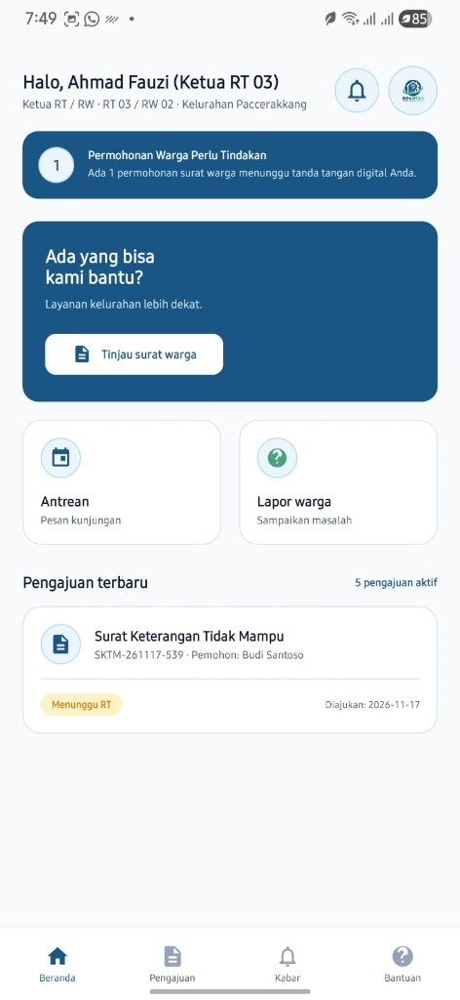

---

### B. Meja Verifikasi Surat Masuk RT/RW & Otorisasi Role
Sesuai aturan administrasi pemerintahan:
* **Ketua RT/RW dan Petugas Kelurahan dilarang membuat surat permohonan warga** (katalog pembuatan surat dinonaktifkan untuk petugas).
* Tab **Pengajuan** bagi petugas beralih fungsi menjadi **Meja Verifikasi Surat Masuk**, menampilkan seluruh surat warga (SKU, SKTM, Surat Domisili, Surat Pengantar) lengkap dengan status verifikasi berjenjang.

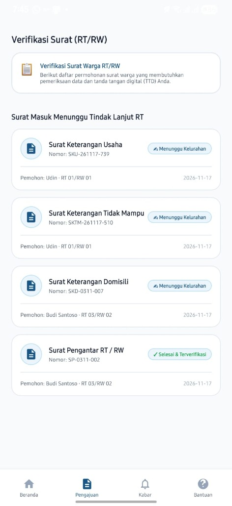

---

### C. Tanda Tangan Digital Elektronik (Canvas Digital Signature)
Petugas RT/RW dapat memeriksa dokumen pemohon dan membubuhkan tanda tangan elektronik langsung di layar HP menggunakan kanvas sentuh interaktif. Goresan tanda tangan dikonversi menjadi berkas gambar PNG beresolusi tajam dan diunggah langsung ke server REST API backend melalui multipart request.

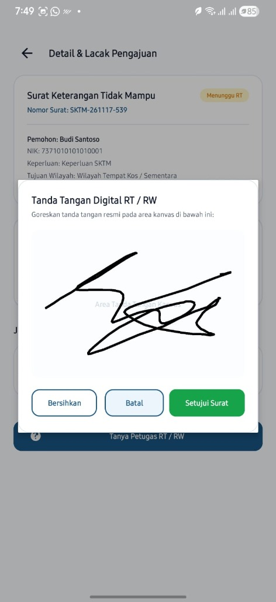

---

### D. Detail Permohonan & Pelacakan Jejak Audit (Audit Trail)
Setiap pengajuan surat dilengkapi jejak riwayat proses (*Audit Log*) transparan yang merekam stempel waktu saat diajukan warga, saat disetujui/ditandatangani RT, hingga diteruskan ke tingkat kelurahan/kecamatan.

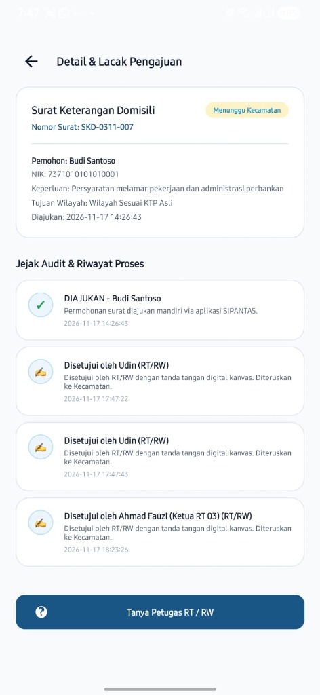

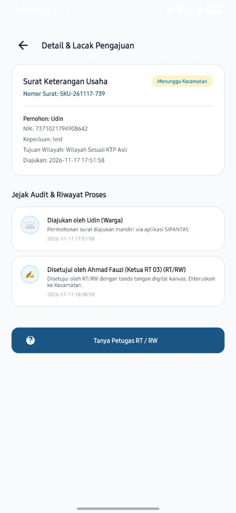

---

### E. Pusat Kabar & Notifikasi Real-time
Warga dan petugas menerima notifikasi otomatis saat ada permohonan surat baru yang masuk atau status surat telah diperbarui, lengkap dengan tab filter kategori (*Semua*, *Surat*, *Antrean*, dan *Laporan*).

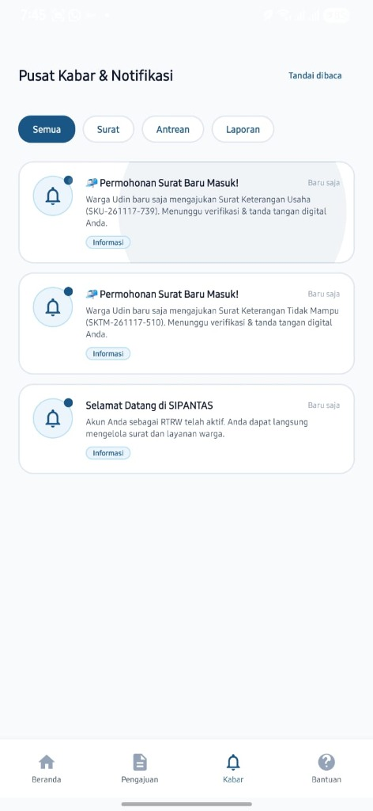

---

## 2. Implementasi CRUD (Create, Read, Update, Delete)

Sistem SIPANTAS mengimplementasikan operasi CRUD secara menyeluruh pada setiap entitas modul:

### A. CRUD Pembuatan Surat Warga (Create) - 3 Langkah Terpadu
Warga dapat membuat permohonan surat baru melalui wizard 3 langkah yang terstruktur:
1. **Langkah 1 (Data Diri):** Memilih tujuan pengantar wilayah (KTP Domisili Tetap vs Tempat Kos/Kontrak Sementara) dan menuliskan keperluan surat.
2. **Langkah 2 (Unggah Berkas):** Melampirkan foto KTP, Kartu Keluarga, atau dokumen pendukung lain dari galeri HP (maks. 2MB).
3. **Langkah 3 (Tinjau & Kirim):** Memeriksa ringkasan permohonan, mencentang pernyataan keabsahan dokumen, dan mengirimkan permohonan ke sistem.

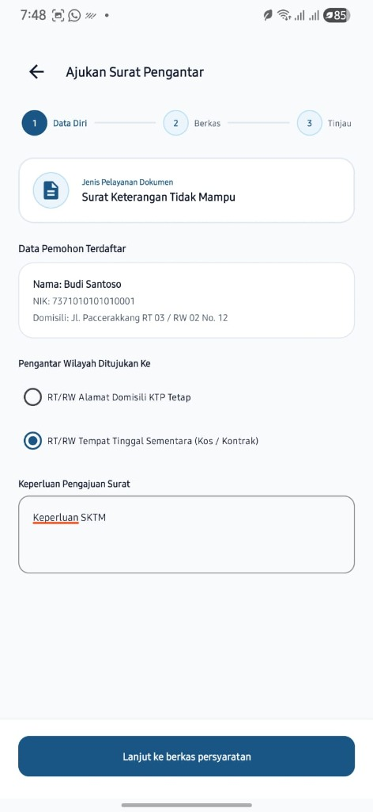

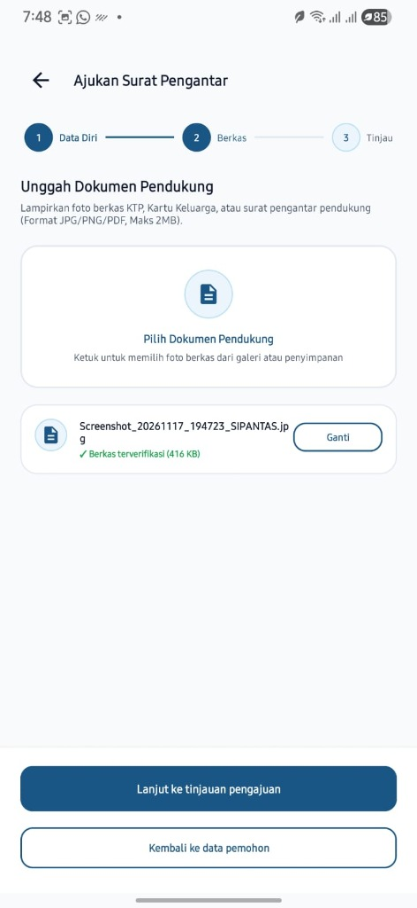

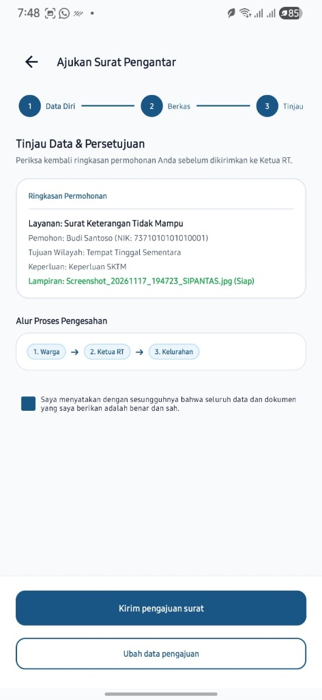

---

### B. CRUD Pembatalan Permohonan Surat (Delete)
Sebelum permohonan ditindaklanjuti oleh petugas RT, warga memiliki hak untuk membatalkan pengajuan surat secara mandiri melalui tombol **"Batalkan Pengajuan Ini"** pada halaman detail surat.

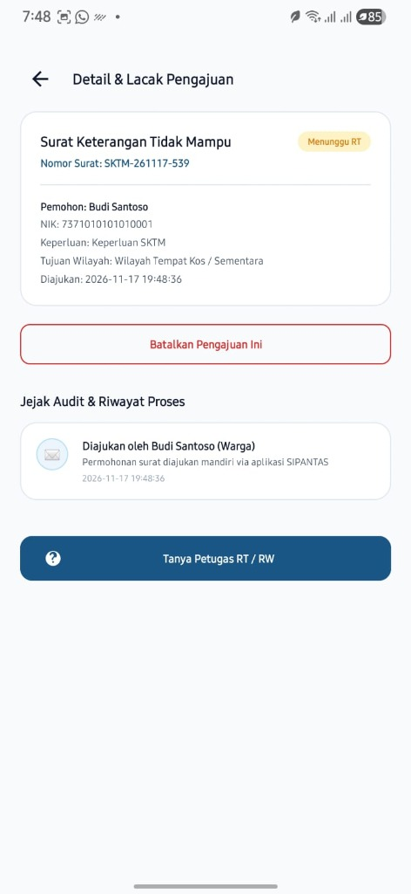

---

### C. CRUD Profil & Avatar Pengguna (Update & Read)
Warga dan petugas dapat memperbarui data kontak dan domisili melalui tombol **"UBAH DATA PROFIL"**, serta mengganti foto avatar profil melalui kamera/galeri yang langsung terunggah ke server.

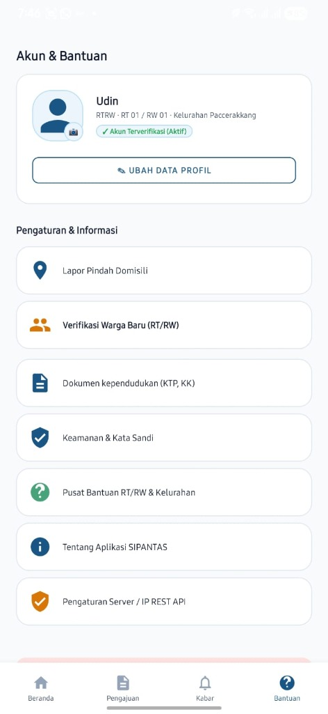

---

### D. Matriks Operasi CRUD Modul Sistem

| Modul Entitas | Create (C) | Read (R) | Update (U) | Delete (D) |
| :--- | :--- | :--- | :--- | :--- |
| **Permohonan Surat** | Pengajuan surat 3 tahap & upload lampiran di `ApplyLetterActivity`. | Menampilkan daftar riwayat surat & status tracking di `ServiceListActivity`. | TTD digital RT/RW & Pengesahan status kelurahan di `LetterDetailActivity`. | Pembatalan surat mandiri via tombol *Batalkan Pengajuan Ini*. |
| **Antrean Kelurahan** | Booking tiket antrean pelayanan (sesi pagi/siang) di `QueueActivity`. | Cek nomor antrean aktif & kuota tersisa secara real-time. | Panggilan nomor urut oleh petugas loket kelurahan. | Pembatalan tiket nomor antrean oleh warga. |
| **Laporan Warga** | Kirim aduan/aspirasi warga + foto bukti di `ReportActivity`. | Monitoring progres tindak lanjut aduan warga. | Pembaruan status penanganan oleh satgas kelurahan. | Penutupan atau penghapusan berkas laporan yang telah selesai. |
| **Akun & Sesi** | Pendaftaran warga & aktivasi akun petugas. | Auto-login sesi pengguna saat membuka aplikasi di `SplashActivity`. | Ubah data profil dan unggah avatar foto profil. | Logout / hapus sesi autentikasi perangkat. |

---

## 3. Basis Data (Database MySQL & phpMyAdmin)

Basis data SIPANTAS dirancang menggunakan **MySQL 8.0** pada database `sipantas_db` melalui antarmuka **phpMyAdmin**, menerapkan integritas referensial dan pengindeksan performa tinggi.

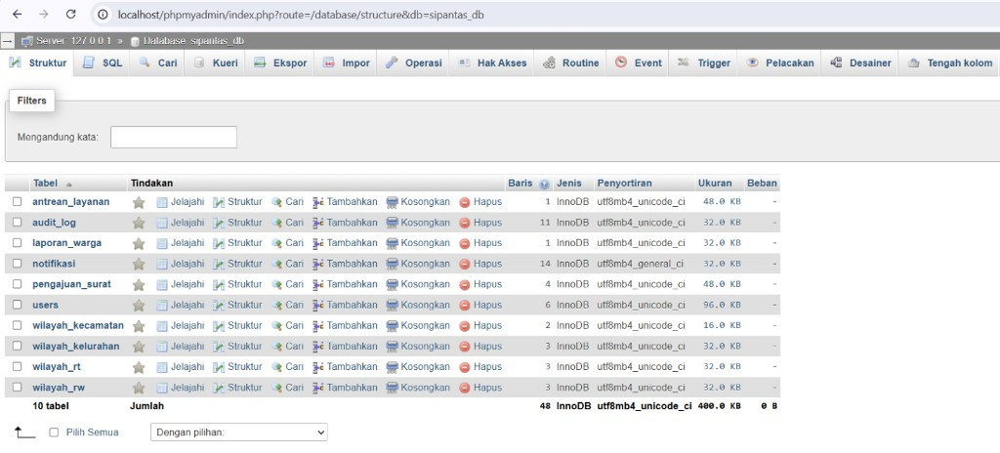

### Struktur 10 Tabel Database (Sesuai phpMyAdmin):
1. **`antrean_layanan`**: Menyimpan data booking tiket nomor antrean loket pelayanan kelurahan, tanggal, sesi waktu, dan status kehadiran.
2. **`audit_log`**: Menyimpan jejak riwayat verifikasi approval surat (*audit trail*), aktor penanggung jawab (Warga / RT / Kelurahan), catatan penolakan/persetujuan, dan stempel waktu (*timestamp*).
3. **`laporan_warga`**: Menyimpan data aduan dan aspirasi kendala lingkungan warga beserta lampiran bukti foto.
4. **`notifikasi`**: Menyimpan riwayat notifikasi *in-app* untuk warga dan petugas terkait pembaruan surat dan pengingat antrean H-1.
5. **`pengajuan_surat`**: Menyimpan data permohonan surat kependudukan, nomor surat unik, status alur berjenjang (*menunggu_rt*, *menunggu_kecamatan*, *selesai*), path berkas tanda tangan RT (`uploads/ttd/`), dan token QR Code resmi.
6. **`users`**: Menyimpan data kredensial akun, NIK (16 digit), nama lengkap, role (`warga`, `rtrw`, `kecamatan`), pemetaan wilayah (`rt_id`, `rw_id`, `kelurahan_id`), dan path foto profil.
7. **`wilayah_kecamatan`**: Menyimpan data master wilayah administratif tingkat kecamatan (Kota Makassar).
8. **`wilayah_kelurahan`**: Menyimpan data master wilayah kelurahan (seperti Kelurahan Paccerakkang, Daya, dll.).
9. **`wilayah_rt`**: Menyimpan data master rukun tetangga (RT) binaan.
10. **`wilayah_rw`**: Menyimpan data master rukun warga (RW) binaan.

---

## 4. REST API (Backend PHP & Retrofit Android)

Komunikasi antara aplikasi Android dan server backend menggunakan arsitektur **RESTful API** berbasis payload data **JSON**:

### A. Pengujian Endpoint REST API
Endpoint diuji menggunakan format respons standar `{ "success": true, "message": "...", "data": [...] }`. Seluruh endpoint backend dapat diakses secara lokal maupun nirkabel melalui IP Wi-Fi laptop (`http://192.168.1.38/api_sipantas/`).

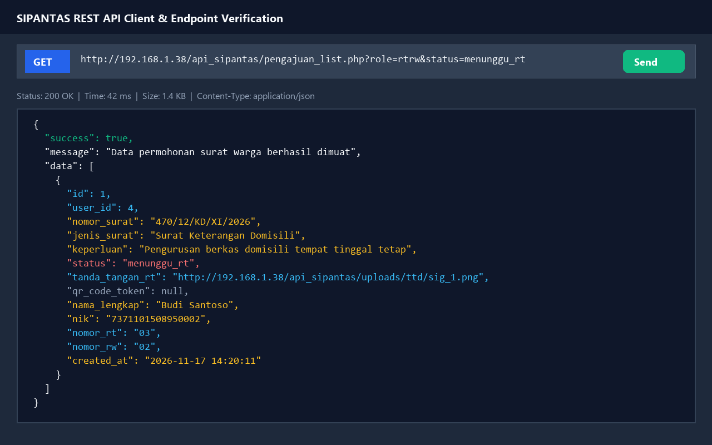

### B. Daftar Endpoint REST API Utama:
* `POST /api_sipantas/login.php` $\rightarrow$ Autentikasi NIK dan password akun.
* `POST /api_sipantas/register.php` $\rightarrow$ Pendaftaran warga dengan Nomor RW dan RT terpisah.
* `POST /api_sipantas/register_officer.php` $\rightarrow$ Aktivasi akun petugas berbasis kode registrasi dan NIK.
* `POST /api_sipantas/update_profile.php` $\rightarrow$ Pembaruan profil & upload multipart foto profil.
* `GET /api_sipantas/pengajuan_list.php` $\rightarrow$ Pengambilan daftar surat berdasarkan role dan filter status.
* `GET /api_sipantas/pengajuan_detail.php` $\rightarrow$ Pengambilan detail surat lengkap dengan riwayat audit log.
* `POST /api_sipantas/pengajuan_action_rt.php` $\rightarrow$ Upload gambar tanda tangan digital dan persetujuan RT/RW.
* `POST /api_sipantas/pengajuan_action_kecamatan.php` $\rightarrow$ Pengesahan akhir dan pembuatan token QR Code.
* `GET /api_sipantas/get_wilayah.php` $\rightarrow$ Pengambilan pohon hierarki wilayah administratif.
* `GET /api_sipantas/get_notifications.php` $\rightarrow$ Pengambilan daftar notifikasi dan pengingat antrean.

---

### C. Version Control & Git Diff di Android Studio
Setiap pembaruan kode tercatat dengan rapi di sistem kontrol versi Git Android Studio, memastikan integritas dan kemudahan pelacakan riwayat perubahan kode:

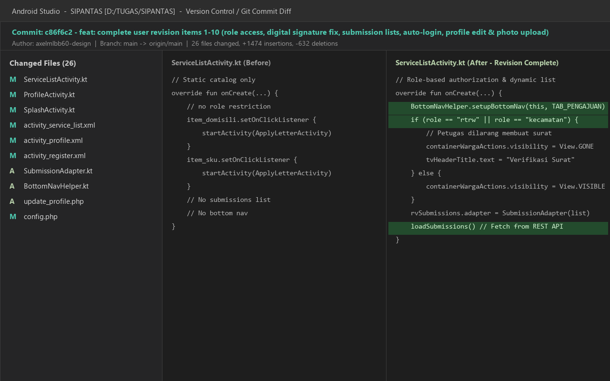

---

## Ringkasan Lokasi Berkas Penting Proyek

| Berkas | Deskripsi |
| :--- | :--- |
| `app/build/outputs/apk/debug/app-debug.apk` | Berkas installer APK Android terbaru (Build Success) |
| `docs/screenshots/` | Folder berisi tangkapan layar antarmuka & dokumentasi logbook |
| `backend_api/` & `C:\xampp\htdocs\api_sipantas\` | Skrip backend PHP REST API & konfigurasi MySQL |
| `app/src/main/java/com/example/sipantas/` | Sumber kode aplikasi Android (Kotlin) |
