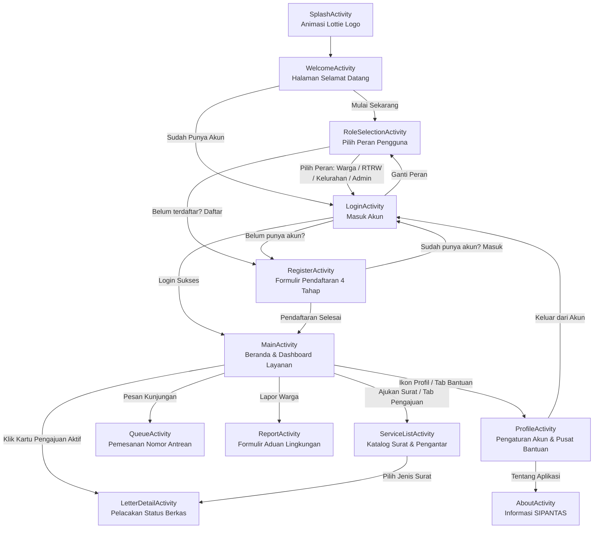

# SIPANTAS — Sistem Pelayanan Administrasi Terpadu Antar Sektor

Aplikasi mobile Android modern untuk digitalisasi dan efisiensi birokrasi pelayanan warga di tingkat lingkungan (RT / RW) dan kantor kelurahan. Warga dapat mengajukan permohonan surat kependudukan secara mandiri, memantau proses verifikasi secara real-time, memesan tiket antrean kantor kelurahan, serta menyampaikan laporan kendala lingkungan dari mana saja.

---

## 📱 Daftar Halaman & Alur Aplikasi

Aplikasi dibangun dengan arsitektur multi-activity terstruktur dan navigasi edge-to-edge:



### Rincian Fitur Antarhalaman:
1. **`SplashActivity`**: Menampilkan animasi logo SIPANTAS beresolusi tinggi dengan Lottie, dilengkapi fallback timeout dan tap-to-skip langsung ke halaman selamat datang.
2. **`WelcomeActivity`**: Halaman pengenalan fitur utama (pengajuan online, pelacakan proses, pusat bantuan) serta tombol ajakan registrasi atau masuk.
3. **`RoleSelectionActivity`**: Pemilihan peran pengguna (*Warga*, *RT / RW*, *Petugas Kelurahan*, dan *Admin Sistem*) yang meneruskan konteks peran ke halaman login, serta link langsung ke registrasi warga.
4. **`LoginActivity`**: Formulir autentikasi pengguna dengan indikator chip peran yang aktif, tombol ganti peran, validasi input, dan opsi registrasi.
5. **`RegisterActivity`**: Wizard pendaftaran interaktif 4 langkah:
   - **Langkah 1:** Data Pribadi (Nama, NIK, No. HP).
   - **Langkah 2:** Alamat & Unggah Foto KTP.
   - **Langkah 3:** Keamanan Akun & Verifikasi Kode OTP 6-Digit.
   - **Langkah 4:** Konfirmasi status berhasil pendaftaran dan akses ke beranda.
6. **`MainActivity`**: Dashboard beranda warga dengan ringkasan status berkas aktif, tombol cepat layanan, navigasi bawah (*Bottom Navigation Bar*), dan akses ke profil.
7. **`ServiceListActivity`**: Daftar katalog surat resmi (Surat Keterangan Domisili, Surat Pengantar RT/RW, SKTM, dan Surat Keterangan Usaha).
8. **`LetterDetailActivity`**: Informasi detail pengajuan surat, tracking timeline verifikasi RT/RW dan kelurahan, serta kontak bantuan petugas.
9. **`QueueActivity`**: Pemesanan antrean pelayanan tatap muka di kantor kelurahan secara online.
10. **`ReportActivity`**: Formulir laporan kendala lingkungan warga disertai lampiran bukti foto.
11. **`ProfileActivity`**: Pengelolaan akun, data dokumen tersimpan, pengaturan keamanan, akses tentang aplikasi, dan fitur logout dengan konfirmasi dialog.
12. **`AboutActivity`**: Informasi profil sistem, visi-misi layanan digital, dan hak cipta aplikasi SIPANTAS.

---

## 🛠️ Tech Stack & Dependencies

- **Platform:** Android (Min SDK 24 / Android 7.0, Target & Compile SDK 35 / Android 15)
- **Language:** Kotlin 2.0.21
- **JVM Target:** Java 11
- **UI & Layouts:** Material Components 3 (`com.google.android.material:material:1.12.0`), `ConstraintLayout 2.2.0`, AndroidX Core KTX, AndroidX AppCompat
- **Animations:** Airbnb Lottie Android (`com.airbnb.android:lottie:6.6.2`)
- **Build System:** Gradle 8.11.1 dengan Kotlin DSL (`build.gradle.kts`) dan Version Catalog (`gradle/libs.versions.toml`)

---

## 📝 Dokumentasi Perubahan & Perbaikan yang Telah Dilakukan

Berikut adalah rekapitulasi lengkap seluruh perbaikan teknis, konfigurasi, navigasi, dan aset visual yang telah dikerjakan di dalam repositori ini:

### 1. Perbaikan Konfigurasi AndroidX (`gradle.properties`)
- **Masalah:** Kompilasi gagal dengan `EvalIssueException: Configuration ':app:debugRuntimeClasspath' contains AndroidX dependencies, but the 'android.useAndroidX' property is not enabled`.
- **Solusi:** Menambahkan properti `android.useAndroidX=true` pada file `gradle.properties` agar Gradle dapat menangani pustaka AndroidX dan Material 3 secara tepat.

### 2. Eliminasi Duplikasi Resource Mipmap Launcher
- **Masalah:** Terjadi konflik `Duplicate resources` pada task `:app:mergeDebugResources` antara file `.png` (logo SIPANTAS) dan file default template `.webp` (robot Android) di seluruh folder densitas `app/src/main/res/mipmap-*` (`hdpi`, `mdpi`, `xhdpi`, `xxhdpi`, `xxxhdpi`).
- **Solusi:** Menghapus 10 file `.webp` template Android Studio dan mempertahankan icon resmi SIPANTAS berformat `.png`.

### 3. Pembenahan Alur Tautan Registrasi
- **Masalah:** Pada `RoleSelectionActivity`, tautan teks di bagian bawah `"Belum terdaftar? Daftar"` (`bottom_login_link`) keliru membuka `LoginActivity`.
- **Solusi:** Mengubah listener klik pada `RoleSelectionActivity.kt` agar langsung membuka `RegisterActivity`, sehingga calon warga yang belum memiliki akun dapat langsung melakukan pendaftaran.

### 4. Perbaikan Navigasi Kembali & Backstack Wizard Register
- **Solusi:** Mengintegrasikan `onBackPressedDispatcher.addCallback` pada `RegisterActivity.kt`. Jika pengguna menekan tombol fisik/gesture kembali dari Android pada langkah 2 atau 3, aplikasi akan mundur ke langkah sebelumnya secara bertahap tanpa menutup form pendaftaran secara mendadak.

### 5. Penyempurnaan Fitur Logout Akun
- **Masalah:** Tombol logout di `ProfileActivity` sebelumnya mengarahkan pengguna ke `WelcomeActivity`.
- **Solusi:** Memperbarui aksi dialog logout di `ProfileActivity.kt` agar mengarahkan pengguna kembali ke `LoginActivity` dengan flag `Intent.FLAG_ACTIVITY_NEW_TASK or Intent.FLAG_ACTIVITY_CLEAR_TASK` serta `finishAffinity()` untuk membersihkan tumpukan aktivitas (*backstack*), disertai pesan konfirmasi Toast `"Berhasil keluar dari akun"`.

### 6. Penyelarasan Latar Belakang Splash Screen & Normalisasi Aset Logo
- **Masalah:** Pada `SplashActivity`, background layar berwarna putih bersih (`#FFFFFF`), namun animasi Lottie di tengah layar (`splash_animation.json`) memiliki background studio abu-abu muda (`#E2E2E2` / RGB 226) bawaan render video dengan tepi kotak persegi (`1:1`). Akibatnya terlihat batas kotak abu-abu yang kontras dan tidak menyatu dengan layar.
- **Solusi:**
  - Memproses seluruh **158 frame WebP** di dalam `app/src/main/res/raw/splash_animation.json` menggunakan skrip otomatisasi grafis untuk menormalkan area latar belakang dan batas tepi menjadi putih bersih (`#FFFFFF`), sehingga animasi membaur 100% mulus dengan splash screen tanpa ada batas kotak terputus.
  - Memperbarui file aset logo utama `app/src/main/res/drawable/ic_sipantas_logo.png` agar memiliki transparansi (*alpha channel*) penuh di bagian luar lingkaran logo, sehingga tampil bersih saat diletakkan di atas kartu/komponen berwarna apa pun.

---

## 🚀 Cara Menjalankan Proyek

### Menggunakan Android Studio
1. Buka **Android Studio** (Koala / Ladybug atau versi yang lebih baru).
2. Pilih **File > Open** dan arahkan ke folder proyek ini (`D:\TUGAS\SIPANTAS`).
3. Tunggu hingga proses **Gradle Sync** selesai.
4. Pilih target perangkat fisik (USB Debugging) atau Emulator (API 24 - 35).
5. Klik tombol **Run 'app'** (ikon segitiga hijau) atau tekan `Shift + F10`.

### Menggunakan Terminal / Command Line
Untuk mengompilasi APK debug:
```bash
# Windows PowerShell / CMD
.\gradlew assembleDebug

# Linux / macOS
./gradlew assembleDebug
```
File APK hasil build akan berada di:
`app/build/outputs/apk/debug/app-debug.apk`

---

## 🌐 Menghubungkan Repositori ke GitHub

Untuk mengunggah (push) repositori ini ke akun GitHub Anda:

1. Buat repositori baru di [GitHub](https://github.com/new) dengan nama **`SIPANTAS`** (pilih *Public* atau *Private*, jangan centang *Add a README file* karena repositori lokal sudah memilikinya).
2. Jalankan perintah berikut di terminal:
```bash
# Tambahkan remote URL GitHub Anda
git remote add origin https://github.com/axelmlbb60-design/SIPANTAS.git

# Pastikan branch utama bernama main
git branch -M main

# Unggah seluruh commit ke GitHub
git push -u origin main
```
