# 🏛️ SIPANTAS — Sistem Informasi Pelayanan Administrasi Warga dan Rukun Tetangga

Aplikasi mobile Android modern dan portal web administrasi terpadu untuk digitalisasi birokrasi pelayanan warga di tingkat lingkungan (**RT / RW**) dan kantor **Kelurahan Laikang, Kecamatan Biringkanaya, Kota Makassar**. 

Dengan SIPANTAS, warga dapat mengajukan permohonan berbagai jenis surat kependudukan secara mandiri dari rumah, memantau proses verifikasi berjenjang secara langsung (*real-time*), memesan nomor antrean loket pelayanan, dan menyampaikan laporan lingkungan hidup secara transparan dan bebas kertas (*paperless*).

* **Repositori Resmi GitHub:** [https://github.com/axelmlbb60-design/SIPANTAS](https://github.com/axelmlbb60-design/SIPANTAS)
* **Branch Utama:** `main`
* **Berkas Installer Aplikasi (Android):** [Unduh APK Debug (11.3 MB)](app/build/outputs/apk/debug/app-debug.apk)
* **Akses Portal Web Admin & Kelurahan:** `http://192.168.1.38/api_sipantas/admin/login.php`

---

## 📌 Daftar Isi Dokumentasi
1. [🌟 Pembaruan & Perubahan Aplikasi Minggu Ini (November 2026)](#1-pembaruan--perubahan-aplikasi-minggu-ini-november-2026)
   * [A. Perubahan Alur Registrasi Warga & Integrasi Database Kartu Keluarga (KK)](#a-perubahan-alur-registrasi-warga--integrasi-database-kartu-keluarga-kk)
   * [B. Penyempurnaan Tampilan Pemilihan Peran & Form Login Adaptif (Tanpa Pop-Up)](#b-penyempurnaan-tampilan-pemilihan-peran--form-login-adaptif-tanpa-pop-up)
   * [C. Isolasi Wilayah & Routing Notifikasi Terpadu (Hierarki Nyata RT & RW)](#c-isolasi-wilayah--routing-notifikasi-terpadu-hierarki-nyata-rt--rw)
   * [D. Tampilan Baru Portal Web Pengelolaan Data (Admin Sistem & Petugas Kelurahan)](#d-tampilan-baru-portal-web-pengelolaan-data-admin-sistem--petugas-kelurahan)
   * [E. Standarisasi Tampilan Dokumen Surat Resmi Kelurahan Laikang dengan QR Code](#e-standarisasi-tampilan-dokumen-surat-resmi-kelurahan-laikang-dengan-qr-code)
   * [F. Matriks Hasil Pengujian Fungsional Aplikasi (Quality Assurance)](#f-matriks-hasil-pengujian-fungsional-aplikasi-quality-assurance)
2. [📱 Galeri Tampilan Fitur Utama Aplikasi Mobile Android](#2-galeri-tampilan-fitur-utama-aplikasi-mobile-android)
   * [A. Beranda & Dashboard Pengawasan Petugas RT/RW](#a-beranda--dashboard-pengawasan-petugas-rtrw)
   * [B. Meja Verifikasi Surat Masuk Khusus Petugas RT & RW](#b-meja-verifikasi-surat-masuk-khusus-petugas-rt--rw)
   * [C. Fitur Tanda Tangan Digital Layar Sentuh (Canvas Digital Signature)](#c-fitur-tanda-tangan-digital-layar-sentuh-canvas-digital-signature)
   * [D. Detail Permohonan & Pelacakan Jejak Riwayat Surat (Audit Trail)](#d-detail-permohonan--pelacakan-jejak-riwayat-surat-audit-trail)
   * [E. Alur 3 Langkah Pembuatan Surat Mandiri oleh Warga](#e-alur-3-langkah-pembuatan-surat-mandiri-oleh-warga)
   * [F. Fitur Pembatalan Surat Mandiri oleh Warga](#f-fitur-pembatalan-surat-mandiri-oleh-warga)
   * [G. Halaman Profil Akun Warga & Unggah Foto Avatar](#g-halaman-profil-akun-warga--unggah-foto-avatar)
   * [H. Pusat Notifikasi & Pesan Kabar Lingkungan](#h-pusat-notifikasi--pesan-kabar-lingkungan)
3. [👥 Matriks Hak Akses Peran Pengguna (Role & Permissions)](#3-matriks-hak-akses-peran-pengguna-role--permissions)
4. [📲 Petunjuk Pengujian dan Penggunaan Aplikasi di HP Android](#4-petunjuk-pengujian-dan-penggunaan-aplikasi-di-hp-android)

---

## 1. 🌟 Pembaruan & Perubahan Aplikasi Minggu Ini (November 2026)

Minggu ini tim pengembang melakukan pembaruan besar yang berfokus pada **perbaikan alur pengguna**, **ketepatan birokrasi pemerintahan lokal di Kelurahan Laikang**, **keamanan autentikasi**, dan **penyediaan portal web desktop** untuk petugas pengelola data.

---

### A. Perubahan Alur Registrasi Warga & Integrasi Database Kartu Keluarga (KK)

Sebelumnya, warga dapat langsung aktif setelah mendaftar. Pada pembaruan ini, alur disempurnakan sesuai regulasi kependudukan resmi:

1. **Pendaftaran Berbasis Database Kartu Keluarga (KK):**
   * Warga mendaftar mandiri cukup dengan memasukkan **Nomor NIK**.
   * Sistem secara otomatis mencocokkan NIK tersebut ke database master Kartu Keluarga Kelurahan Laikang untuk mendeteksi nama asli, nomor RT, dan nomor RW secara akurat.
2. **Status Akun Baru Menunggu Verifikasi:**
   * Akun baru yang didaftarkan berstatus **Menunggu Verifikasi** dan belum dapat langsung login ke aplikasi.
   * Warga diwajibkan mengirimkan foto KTP/KK ke Ketua RT setempat.
3. **Persetujuan & Penarikan Data Otomatis oleh Ketua RT:**
   * Ketua RT memeriksa keabsahan warga baru melalui menu verifikasi di aplikasi.
   * Saat Ketua RT menekan tombol **"Verifikasi & Aktifkan"**, seluruh data resmi Kartu Keluarga (No KK, nama orang tua, pekerjaan, pendidikan, tanggal lahir, dan status perkawinan) otomatis ditarik dan masuk ke profil akun warga.
   * Warga menerima notifikasi bahwa akun telah aktif dan dapat langsung menggunakan layanan persuratan.

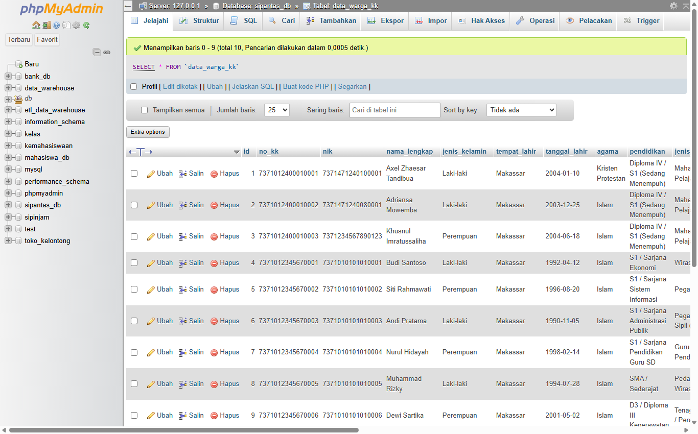
*Tampilan struktur database master kependudukan Kartu Keluarga (KK) Kelurahan Laikang.*

---

### B. Penyempurnaan Tampilan Pemilihan Peran & Form Login Adaptif (Tanpa Pop-Up)

Berdasarkan masukan pengguna saat pengujian di ponsel fisik:

1. **Penghapusan Dialog Pop-Up yang Mengganggu:**
   * Pada halaman **"Masuk sebagai apa?"** (*RoleSelectionActivity*), tombol peran (*Warga*, *Ketua RT*, *Ketua RW*, *Petugas Kelurahan*, *Admin Sistem*) kini langsung membuka form login tanpa memunculkan kotak dialog konfirmasi pop-up.
2. **Form Input Login yang Menyesuaikan Peran Secara Otomatis:**
   * **Admin Sistem & Petugas Kelurahan:** Kolom input otomatis berlabel **Username** dengan petunjuk *"Masukkan username..."*, serta tautan pendaftaran mandiri disembunyikan karena akun pejabat resmi disediakan oleh sistem.
   * **Ketua RT & Ketua RW:** Kolom input otomatis berlabel **Username / NIK**, dan tautan pendaftaran mandiri disembunyikan.
   * **Warga:** Kolom input berlabel **Nomor NIK** (16 digit angka) lengkap dengan tautan *"Belum punya akun? Daftar"* untuk registrasi mandiri.

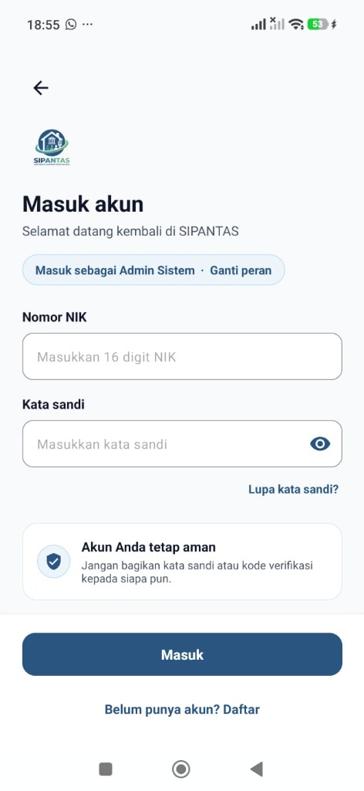
*Tampilan form login Android adaptif: Label kolom identifier otomatis menyesuaikan peran tanpa pop-up dialog.*

---

### C. Isolasi Wilayah & Routing Notifikasi Terpadu (Hierarki Nyata RT & RW)

Sesuai kondisi nyata di Kelurahan Laikang, **1 RW menaungi beberapa RT** (misalnya RW 03 menaungi RT 01, RT 02, RT 03, dst.). Sistem sekarang menerapkan pembatasan wilayah yang sangat ketat:

* **Saat Warga Mengajukan Surat (Status: Menunggu RT):**
  * Notifikasi permohonan baru **HANYA** masuk ke Ketua RT yang menaungi warga tersebut.
  * Ketua RT di lingkungan lain (misal RT 02) maupun Ketua RW **TIDAK AKAN** menerima notifikasi dan tidak melihat surat tersebut di antreannya.
* **Saat Ketua RT Menyetujui Surat (Status: Menunggu RW):**
  * Surat diteruskan ke tahap berikutnya. Notifikasi tanda tangan **HANYA** masuk ke Ketua RW yang menaungi RT tersebut (misal RW 03).
  * Ketua RW di wilayah lain (RW 01 atau RW 02) tidak menerima notifikasi.
  * Warga pemohon mendapatkan kabar bahwa surat telah disetujui RT dan sedang diproses RW.
* **Saat Ketua RW Menyetujui Surat (Status: Menunggu Kelurahan):**
  * Surat diteruskan ke meja Petugas Kelurahan Laikang untuk pengesahan akhir dan penerbitan stempel/QR Code resmi.

---

### D. Tampilan Baru Portal Web Pengelolaan Data (Admin Sistem & Petugas Kelurahan)

Untuk memudahkan pengelolaan data kependudukan skala besar dari laptop/komputer kantor, telah disediakan portal web terpadu dengan antarmuka modern dan responsif:

#### 1. Halaman Login Portal Web
Mendukung pemilihan tab peran antara **Administrator Sistem** dan **Petugas Kelurahan**, serta dilengkapi tombol *Quick Demo Login* untuk mempermudah demonstrasi.

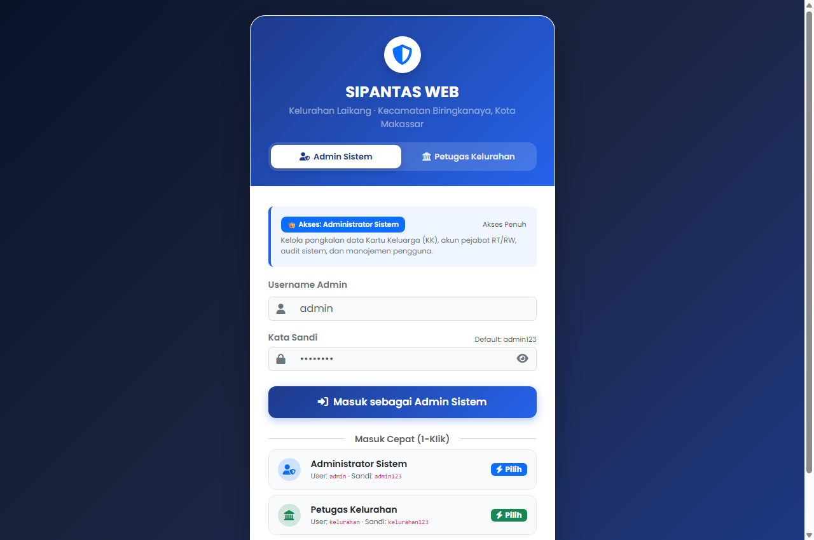

#### 2. Dashboard Statistik Pelayanan
Menampilkan ringkasan metrik secara langsung: Total Pengajuan Surat, Surat Selesai Diterbitkan, Total Warga Aktif, Warga Menunggu Verifikasi, Jumlah Pejabat RT/RW, dan Total Petugas Kelurahan.

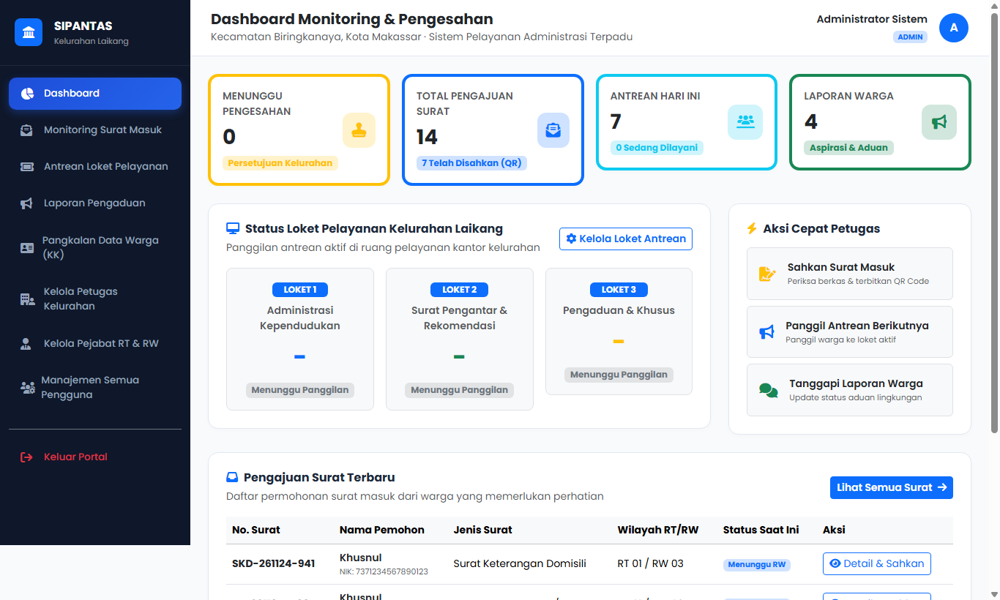

#### 3. Manajemen Database Warga Kartu Keluarga (KK)
Admin dapat menambah data warga baru ke dalam database master Kartu Keluarga, memperbarui data domisili, mencari warga berdasarkan NIK/Nama, serta mencetak daftar warga per wilayah.

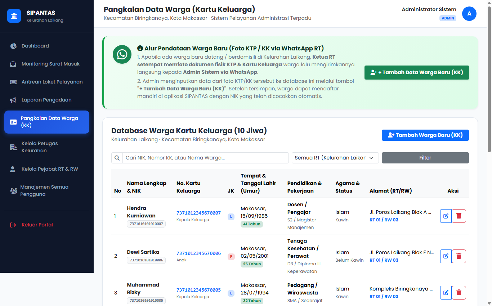

#### 4. Manajemen Akun Pejabat RT & RW (Kemudahan Ganti Pengurus)
Admin dapat mendaftarkan akun Ketua RT atau Ketua RW baru dengan penetapan wilayah penugasan otomatis. Apabila masa bakti ketua RT/RW berganti, admin cukup menekan tombol **"Ganti Kata Sandi"** untuk pejabat baru **tanpa perlu membuat akun baru dari awal**, sehingga seluruh rekam jejak surat wilayah tetap terjaga rapi.

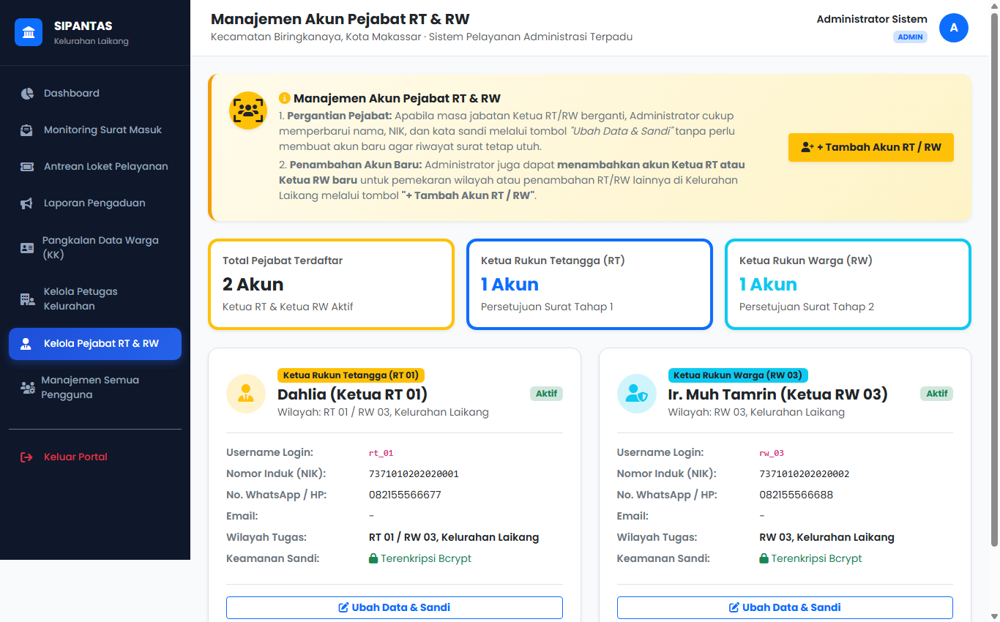

#### 5. Manajemen Petugas Kelurahan
Admin dapat menambah akun staf pelayanan kantor kelurahan baru dan mengelola kredensial hak akses operasional.

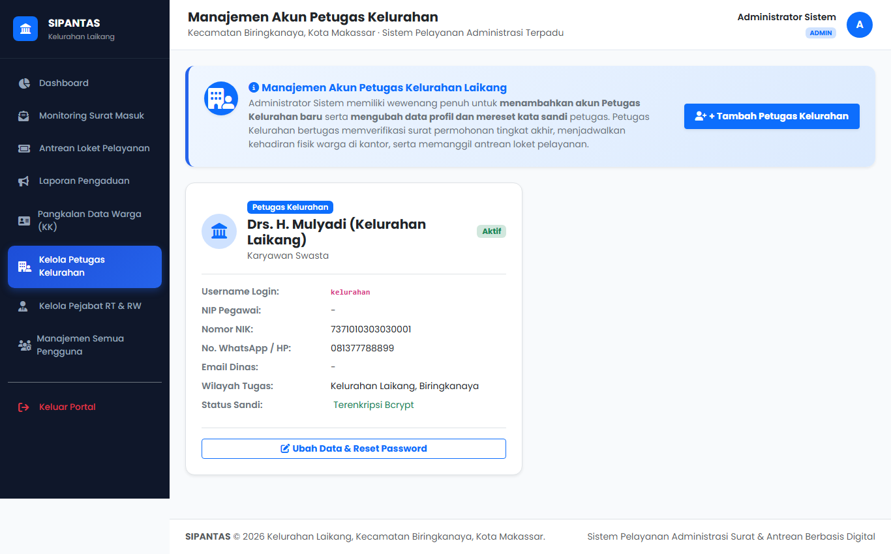

#### 6. Meja Verifikasi & Pengesahan Surat Kantor Kelurahan
Petugas kelurahan dapat memeriksa berkas lampiran warga, mengesahkan surat dengan tanda tangan digital, menentukan jadwal hari/jam kedatangan pengambilan surat fisik, atau memberikan catatan penolakan resmi jika dokumen belum lengkap.

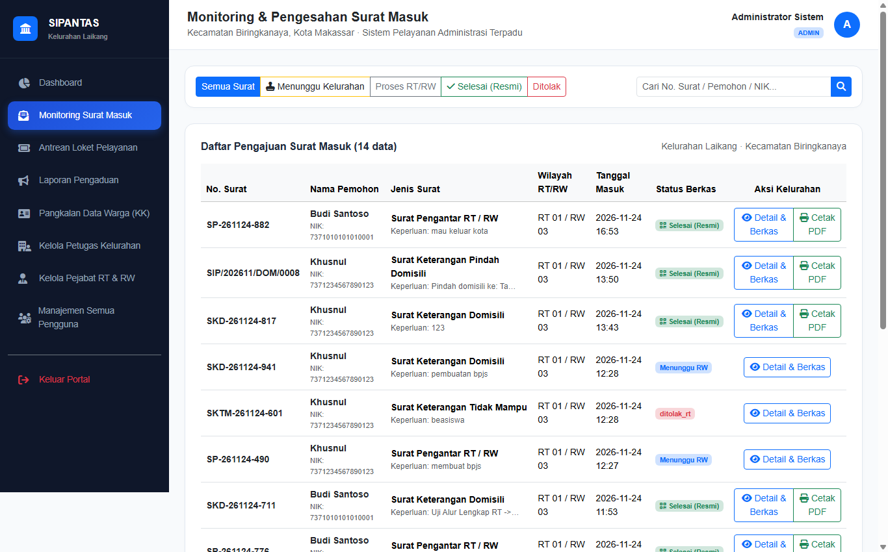

---

### E. Standarisasi Tampilan Dokumen Surat Resmi Kelurahan Laikang dengan QR Code

Surat keterangan kependudukan yang selesai disahkan diterbitkan mengikuti format baku kedinasan resmi Pemerintah Kota Makassar:
* **Kop Surat Kedinasan:** Menampilkan lambang resmi Kota Makassar, Pemerintah Kota Makassar, Kecamatan Biringkanaya, dan Kelurahan Laikang.
* **Informasi Lengkap Pemohon:** Mencantumkan Nama, NIK, No. KK, Tempat/Tgl Lahir, Jenis Kelamin, Agama, Pekerjaan, dan Alamat Domisili lengkap yang ditarik dari database Kartu Keluarga.
* **Tanda Tangan Berjenjang:** Memuat kolom tanda tangan digital resmi Ketua RT, Ketua RW, dan Lurah / Kepala Seksi Pemerintahan Kelurahan Laikang.
* **QR Code Verifikasi Dokumen:** Kode batang digital yang dapat dipindai langsung menggunakan kamera HP untuk memvalidasi keaslian dokumen secara instan dan mencegah pemalsuan surat.

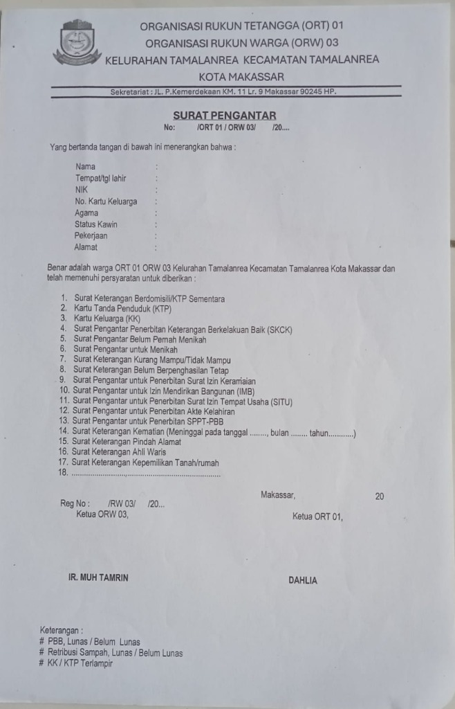
*Format resmi cetak surat keterangan digital Kelurahan Laikang lengkap dengan tanda tangan berjenjang dan QR Code validasi.*

---

### F. Matriks Hasil Pengujian Fungsional Aplikasi (Quality Assurance)

Seluruh fitur baru telah melalui pengujian pengoperasian fungsional:

| No | Fitur / Skenario yang Diuji | Hasil Pengujian Aplikasi | Status |
| :-: | :--- | :--- | :---: |
| 1 | **Pendaftaran Warga Baru via NIK** | Data nama dan nomor RT/RW otomatis terisi dari data Kartu Keluarga. Status awal: `Menunggu Verifikasi`. | **BERHASIL (Passed)** ✅ |
| 2 | **Pencegahan Login Akun Belum Aktif** | Warga yang belum diverifikasi RT ditolak saat login dengan pesan informatif agar menghubungi pengurus RT. | **BERHASIL (Passed)** ✅ |
| 3 | **Verifikasi Akun oleh Ketua RT** | Ketua RT membuka daftar warga baru, memeriksa berkas, dan menekan aktifkan. Profil akun warga langsung tersinkron data KK. | **BERHASIL (Passed)** ✅ |
| 4 | **Pengajuan Surat oleh Warga** | Notifikasi surat baru **hanya** berdering di HP Ketua RT tempat warga tinggal. HP RT lain tetap tenang tanpa gangguan. | **BERHASIL (Passed)** ✅ |
| 5 | **Isolasi Antrean Surat RT** | Ketua RT dari wilayah berbeda membuka aplikasi dan antreannya bersih, tidak melihat surat dari RT lain. | **BERHASIL (Passed)** ✅ |
| 6 | **Persetujuan RT & Lanjut ke RW** | Ketua RT menandatangani di layar HP. Surat otomatis berpindah ke antrean Ketua RW pembinanya saja. | **BERHASIL (Passed)** ✅ |
| 7 | **Isolasi Antrean Surat RW** | Ketua RW di luar wilayah tidak dapat melihat atau memproses surat milik RW lain. | **BERHASIL (Passed)** ✅ |
| 8 | **Pengesahan Akhir di Kelurahan** | Petugas kelurahan mengesahkan surat, jadwal pengambilan fisik ditentukan, dan status surat berubah menjadi `Selesai`. | **BERHASIL (Passed)** ✅ |
| 9 | **Ganti Pengurus RT/RW di Web Admin** | Admin mereset password akun RT ke pengurus baru; riwayat surat lama tidak hilang dan pejabat baru langsung dapat login. | **BERHASIL (Passed)** ✅ |
| 10 | **Navigasi Login Tanpa Pop-Up** | Pemilihan peran langsung membuka form login yang rapi sesuai tipe akun yang dipilih. | **BERHASIL (Passed)** ✅ |

---

## 2. 📱 Galeri Tampilan Fitur Utama Aplikasi Mobile Android

Berikut adalah tampilan antarmuka visual aplikasi SIPANTAS pada perangkat ponsel cerdas (*smartphone*) Android:

### A. Beranda & Dashboard Pengawasan Petugas RT/RW
Menampilkan ringkasan kartu statistik permohonan warga yang butuh verifikasi, tombol pintasan aksi cepat, pemesanan tiket antrean kantor kelurahan, serta pemantauan laporan kebersihan dan ketertiban lingkungan.

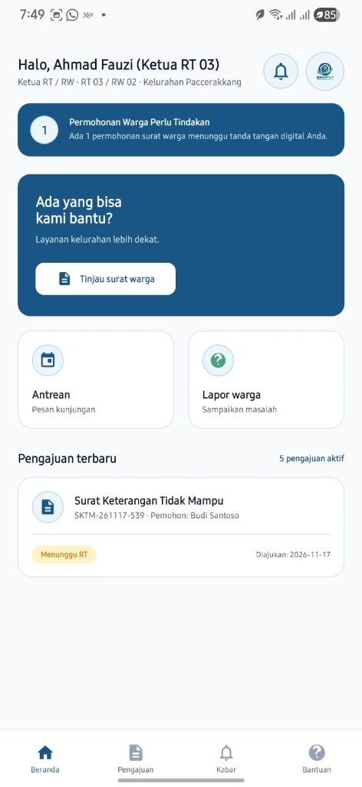

---

### B. Meja Verifikasi Surat Masuk Khusus Petugas RT & RW
Sesuai aturan pemerintahan, petugas RT dan RW difokuskan untuk pelayanan dan verifikasi. Tab persuratan beralih fungsi menjadi meja verifikasi surat masuk yang mengelompokkan surat berdasarkan status penanganan berjenjang.

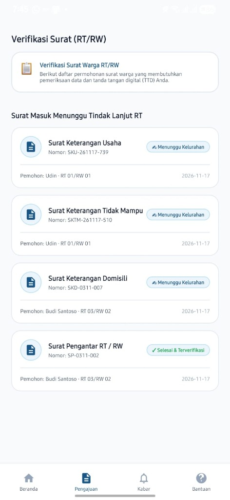

---

### C. Fitur Tanda Tangan Digital Layar Sentuh (Canvas Digital Signature)
Petugas RT dan RW membubuhkan tanda tangan elektronik resmi langsung di atas layar ponsel menggunakan sentuhan jari atau stylus pen secara alami. Tanda tangan tersimpan tajam dan aman pada dokumen resmi.

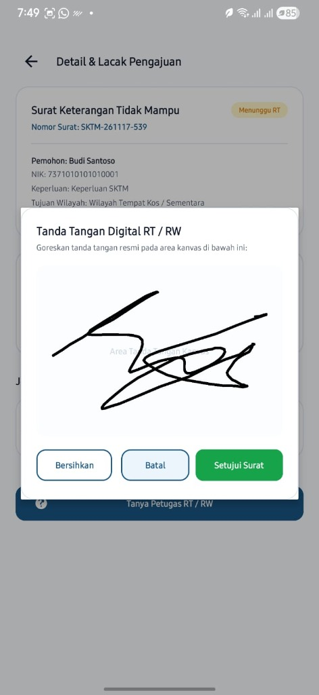

---

### D. Detail Permohonan & Pelacakan Jejak Riwayat Surat (Audit Trail)
Setiap pengajuan surat dilengkapi buku jejak digital (*Audit Log*) yang mencatat tanggal, jam, nama petugas, dan tindakan yang diambil (pengajuan, persetujuan RT, persetujuan RW, hingga pengesahan lurah) sehingga proses birokrasi berlangsung transparan.

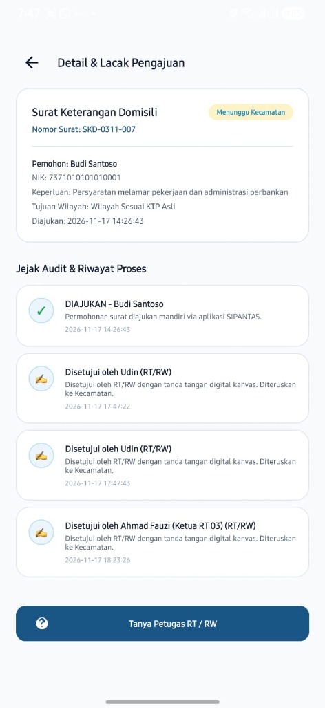

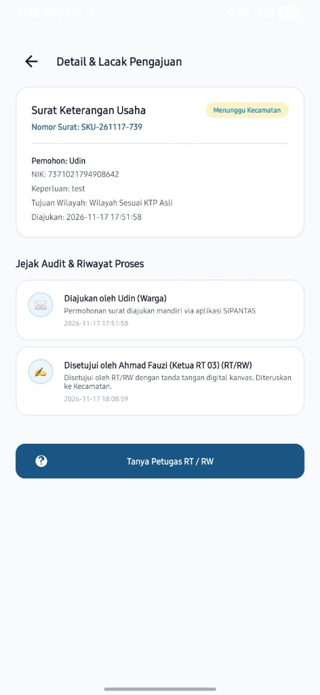

---

### E. Alur 3 Langkah Pembuatan Surat Mandiri oleh Warga
Warga dapat membuat surat pengantar dengan panduan wizard 3 langkah yang mudah dipahami:
1. **Langkah 1 (Data Keperluan):** Memilih tujuan wilayah pengantar (warga tetap atau tempat kos) dan mengisi maksud permohonan.
2. **Langkah 2 (Unggah Dokumen):** Melampirkan foto KTP, KK, atau bukti pendukung langsung dari galeri atau kamera HP.
3. **Langkah 3 (Tinjau & Kirim):** Memeriksa seluruh isian sebelum surat dikirimkan ke meja Ketua RT.

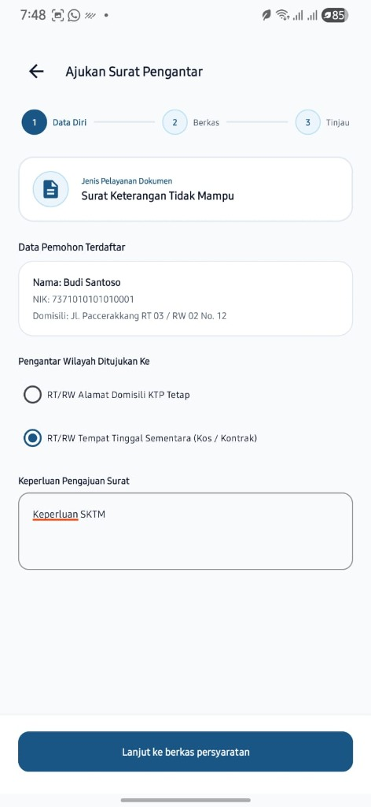

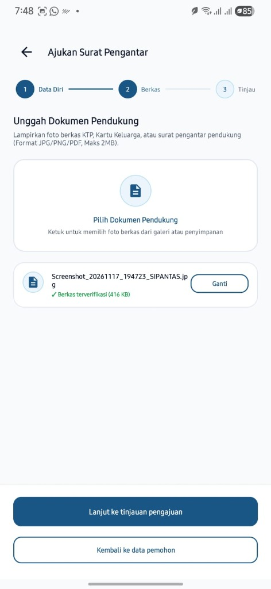

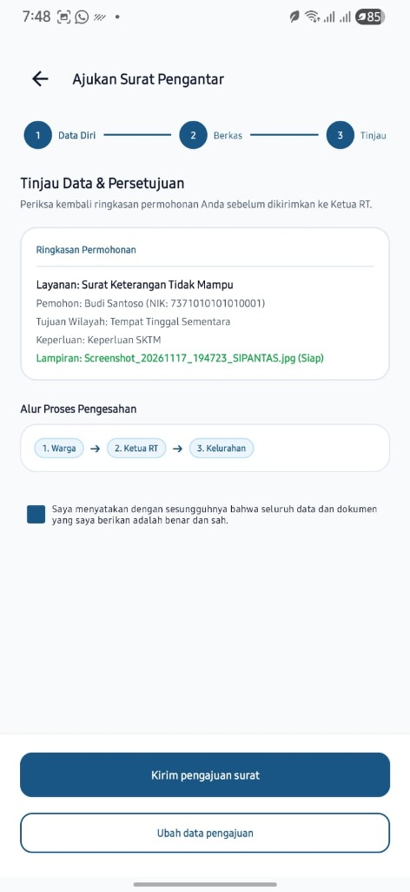

---

### F. Fitur Pembatalan Surat Mandiri oleh Warga
Apabila warga menyadari ada kekeliruan data sebelum surat ditandatangani oleh Ketua RT, warga dapat membatalkan pengajuan secara mandiri melalui tombol **"Batalkan Pengajuan Ini"**.

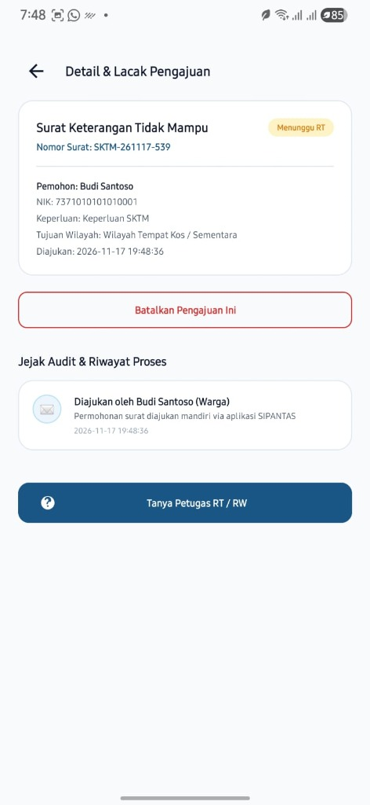

---

### G. Halaman Profil Akun Warga & Unggah Foto Avatar
Menampilkan data lengkap kependudukan sesuai Kartu Keluarga resmi, tombol ubah nomor telepon/email, serta fitur penggantian foto profil pengguna.

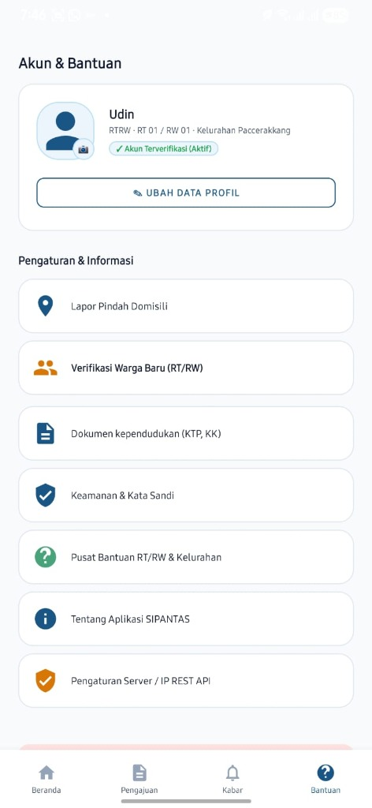

---

### H. Pusat Notifikasi & Pesan Kabar Lingkungan
Pusat pemberitahuan lengkap dengan tab kategori filter (*Semua*, *Surat*, *Antrean*, dan *Laporan*) yang selalu memperbarui status proses surat warga secara instan.

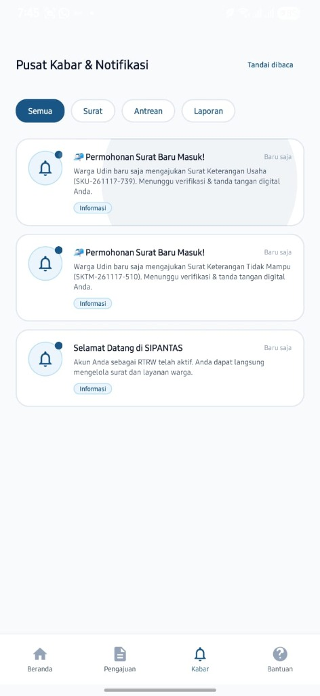

---

## 3. 👥 Matriks Hak Akses Peran Pengguna (Role & Permissions)

Sistem SIPANTAS dirancang dengan pembagian kewenangan yang jelas untuk mencegah tumpang tindih birokrasi:

| Peran Pengguna | Akses Login | Hak Akses Pembuatan Surat | Hak Verifikasi & Tindak Lanjut | Menu Khusus Tambahan |
| :--- | :--- | :---: | :---: | :--- |
| **Warga** | Nomor NIK & Password | **Ya (Mandiri)** | Memantau & membatalkan surat miliknya | Booking antrean kelurahan, kirim laporan aduan lingkungan |
| **Ketua RT** | Username / NIK & Password | Tidak (Khusus Pelayanan) | Verifikasi & TTD digital surat warga di wilayah RT-nya | Verifikasi aktivasi akun warga baru di RT bersangkutan |
| **Ketua RW** | Username / NIK & Password | Tidak (Khusus Pelayanan) | Verifikasi & TTD digital surat dari seluruh RT binaan RW-nya | Monitoring rekapitulasi surat tingkat rukun warga |
| **Petugas Kelurahan** | Username & Password | Tidak (Khusus Pengesahan) | Pengesahan akhir surat, penjadwalan pengambilan, & QR Code | Pengelolaan loket tiket antrean fisik kelurahan |
| **Admin Sistem** | Username & Password (Web) | Tidak (Khusus Kelola Sistem) | Manajemen penuh database kependudukan & akun | Kelola data KK, tambah RT/RW, reset kata sandi pejabat |

---

## 4. 📲 Petunjuk Pengujian dan Penggunaan Aplikasi di HP Android

1. **Persiapan Koneksi:**
   * Pastikan perangkat laptop (server lokal) dan ponsel Android Anda terhubung ke jaringan Wi-Fi yang sama.
   * Alamat IP Server default: `http://192.168.1.38/api_sipantas/`.
2. **Pemasangan Aplikasi di HP:**
   * Salin berkas [app-debug.apk](app/build/outputs/apk/debug/app-debug.apk) ke memori HP Android Anda, lalu buka berkas untuk menginstal.
   * Apabila muncul peringatan instalasi sumber tidak dikenal, pilih *"Tetap Instal"*.
3. **Pengaturan Alamat Server di Aplikasi:**
   * Buka aplikasi SIPANTAS. Jika muncul pemberitahuan sambungan server, ketuk tombol **"Ubah URL Server"**, pastikan terisi:
     `http://192.168.1.38/api_sipantas/` lalu simpan.
4. **Akun Uji Coba Cepat (Demo):**
   * **Warga Aktif:** NIK `7371471240100001` / Password: `password123` *(Axel Zhaesar Tandibua - RT 01 / RW 03)*
   * **Ketua RT 01:** Username `rt_01` atau NIK `7371010202020001` / Password: `password123` *(Dahlia - Ketua RT 01)*
   * **Ketua RW 03:** Username `rw_03` atau NIK `7371010202020002` / Password: `password123` *(Ir. Muh Tamrin - Ketua RW 03)*
   * **Petugas Kelurahan:** Username `kelurahan` / Password: `password123` *(Drs. H. Mulyadi)*
   * **Admin Web:** Akses melalui browser komputer di `http://localhost/api_sipantas/admin/login.php` dengan Username `admin` / Password: `admin`.
